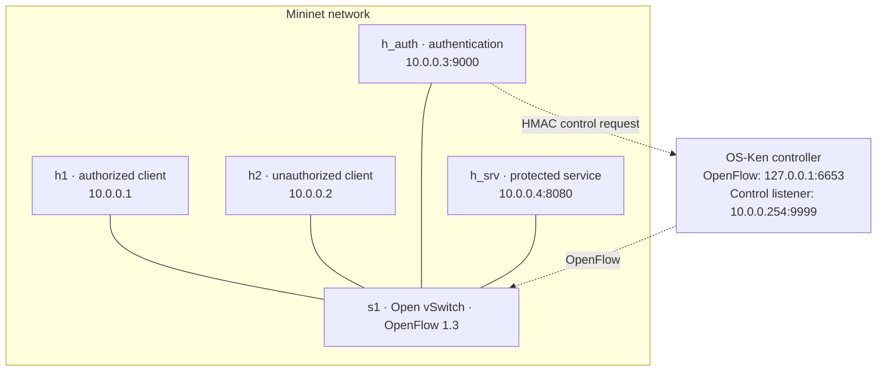

<div align="center">

# SDN-Based Authentication<br>and Dynamic Access Control

**Authenticate a user. Update the switch. Grant temporary access.**

Python TCP sockets · Mininet · Open vSwitch · OpenFlow 1.3 · OS-Ken

[Getting started](#getting-started) · [Live demo](#live-demo) · [Results](#performance-results) · [Documentation](#documentation)

</div>

---

An academic Computer Networks project that connects application authentication
to network access policy. A successful login causes the SDN controller to install
a temporary, source-specific OpenFlow rule for a protected TCP service. Logout
and session expiry remove access while unauthorized clients remain blocked.

**Team 1 · Project 2 — Authentication and Network Access Control**

| Validation in the Ubuntu VM — 25 October 2026 | Result |
|---|---|
| Isolated regression suite | **75 methods passed**, in checkout and extracted package |
| Normal Mininet integration run | **80 checkpoint verdicts passed** |
| Clean startup and retained-log demonstration | **Passed** |
| Current performance batch | **20 dynamic + 20 static trials**, all observations retained |

The repeated isolated runs use the same 75 cases; the 80 checkpoints are not
80 separate demonstrations. See the [validation record](docs/VALIDATION.md).

## What the project demonstrates

- **Authentication and sessions:** login/logout, random IP-bound tokens, concurrent
  users, expiry and temporary failed-login lockout.
- **Dynamic network policy:** scoped, finite OpenFlow grants driven by application
  events, with confirmed revocation and visible retryable failures.
- **Authenticated control requests:** HMAC-SHA-256, per-connection challenges,
  timestamp checks and strict JSON validation.
- **Bounded TCP protocols:** newline framing, message-size limits, absolute receive
  deadlines and connection caps.
- **Measured evaluation:** a static-rule baseline, preserved historical data and
  validated current measurements.

The normal session lease is **60 seconds**. Three failed attempts trigger a
**60-second lockout**. Sessions from the same source IP share a switch grant;
state transitions are serialized and overlapping sessions retain their remaining
access. Expiry is swept every second, and failed revocations remain retryable.

## Architecture



Solid lines show host/switch links. Dashed arrows show logical control channels.
The root namespace joins the emulated LAN through `ctrlroot0` / `ctrlovs0`,
providing the management address `10.0.0.254`. Custom TCP **9999** carries
application commands; OpenFlow TCP **6653** connects the switch to the controller.

### Access policy

| Priority | Match | Action |
|---:|---|---|
| **200** | Authorized source IP → `10.0.0.4`, TCP destination port `8080` | Temporary allow with finite hard timeout |
| **100** | Traffic to `10.0.0.4`, TCP destination port `8080` | Drop |
| **0** | Other traffic | OVS `NORMAL` forwarding |

ARP, ICMP and unrelated traffic can pass. The grant cookie
`0x53444e4155544801` and strict deletion scope revocation to this application's
rules. A barrier and correlated errors confirm switch processing; service probes
separately verify forwarding.

### Request lifecycle

1. A client is initially denied access to the protected service.
2. The authentication server validates credentials and requests a signed grant.
3. The controller verifies the request and confirms the switch update.
4. The server commits the session; the client can access the protected service.
5. Confirmed logout or lease expiry restores denial. Unconfirmed revocation is
   reported and remains retryable.

## Getting started

### 1. Prepare the Ubuntu environment

Use an Ubuntu VM with **Mininet, an active Open vSwitch service, Python 3.11**,
and the `ip`, `ovs-vsctl` and `ovs-ofctl` tools already available. Mininet and
application processes use system Python; OS-Ken uses the local `.venv311`.

For a new checkout:

```bash
git clone https://github.com/Akash-1271/sdn-authentication-dynamic-access-control.git
cd sdn-authentication-dynamic-access-control
python3.11 -m venv .venv311
.venv311/bin/python -m pip install -r requirements.txt
.venv311/bin/python -m pip check
```

Run every demo terminal from this clone root. On the existing tested VM, keep
using `/home/akash/cn-project-fallback` and its working environment; do not
recreate it for a demonstration.

<details>
<summary><strong>Tested versions and reproduction limits</strong></summary>

| Component | Validated version |
|---|---|
| Ubuntu | 26.04 LTS, VirtualBox |
| System Python | 3.14.4 |
| Controller Python | 3.11.13 |
| OS-Ken | 3.1.1 |
| Mininet | 2.3.0 |
| Open vSwitch | 3.7.1; database schema 8.8.0 |

`requirements.txt` pins OS-Ken. System packages and transitive dependencies are
not fully locked, and fresh-machine provisioning was not executed during final
verification. Eventlet deprecation/RLock warnings remain visible in the tested
environment. HMAC, sockets, JSON and threading use the Python standard library.

</details>

### 2. Configure the private control key

The controller and authentication server require the **same private key file**
through `SDN_CONTROL_SECRET_FILE`. There is no unauthenticated fallback.

In your Ubuntu desktop terminal:

```bash
export SDN_CONTROL_SECRET_FILE="${XDG_RUNTIME_DIR:-/run/user/$(id -u)}/sdn-control.key"
python3 control_security.py --generate-key "$SDN_CONTROL_SECRET_FILE"
```

Generate only if the key is absent. The generator creates a new mode-`0600`
256-bit key file and refuses to overwrite an existing file. The loader rejects
malformed, oversized, insufficiently varied, symlinked or group/world-readable
keys. Keep the file outside the repository; never print or publish its contents.
The environment variable contains its **path**, not its value.

Runtime directories can be cleared after logout/reboot. Rotation requires
configuring and restarting both components; the controller loads its key at
startup and the control client reads it for each command.

### 3. Start the topology, then the controller

Inspect current listeners, interfaces and `ovs-vsctl show` first. The topology
refuses conflicting `s1` or control-interface names. Inspect stale state before
changing it; do not use broad `mn -c`, `pkill` or `killall` cleanup.

**Terminal A — topology first:**

```bash
sudo /usr/bin/python3 topology.py
```

Leave Mininet open. An initial warning that the remote controller is unavailable
is expected: the topology must create `10.0.0.254` before the custom listener can bind.

**Terminal B — controller:**

```bash
export SDN_CONTROL_SECRET_FILE="${XDG_RUNTIME_DIR:-/run/user/$(id -u)}/sdn-control.key"
.venv311/bin/osken-manager --ofp-listen-host 127.0.0.1 --ofp-tcp-listen-port 6653 controller.py
```

The default custom listener is `10.0.0.254:9999`; its permitted peer is
`10.0.0.3` (`h_auth`). Controlled isolated tests can use `SDN_CONTROL_HOST` and
`SDN_CONTROL_ALLOWED_PEER`; wildcard binding is rejected and HMAC remains mandatory.

### 4. Start the service and authentication server

Run `id -u` in your desktop terminal. Replace **1000** below with that UID and
match the actual runtime key path chosen earlier. A desktop export does not
configure an already running Mininet host.

In Mininet, verify `h1 pwd` shows the clone root. Choose a new directory name in
place of `UNIQUE`; continue only if `mkdir` succeeds:

```text
sh mkdir -m 700 /tmp/sdn-demo-UNIQUE
h_srv python3 -u ./protected_service.py > /tmp/sdn-demo-UNIQUE/service.log 2>&1 &
h_auth env AUTH_LOG_FILE=/tmp/sdn-demo-UNIQUE/authentication.log SDN_CONTROL_SECRET_FILE=/run/user/1000/sdn-control.key python3 -u ./auth_server.py > /tmp/sdn-demo-UNIQUE/auth-console.log 2>&1 &
```

The root authentication process can read the desktop user's private file.
Record each background PID immediately (`h_srv echo $!` / `h_auth echo $!`).
Logs stay outside the clone; the default auth log, if `AUTH_LOG_FILE` is omitted,
is ignored `security.log`.

## Live demo

### Login, access and logout

Run these in Mininet:

```text
pingall
h1 python3 ./test_auth.py
h1 python3 ./test_concurrency.py
h_auth env SDN_CONTROL_SECRET_FILE=/run/user/1000/sdn-control.key python3 ./test_controller_client.py
h1 python3 ./client.py
h2 python3 ./test_lockout_network.py
```

The client logs in, requests protected data and confirms logout. The intentional
demo-only accounts are `alice` / `123` and `bob` / `456`; never reuse real passwords.

### Prove denial and expiry

```text
h_srv python3 -c 'from client import access_protected_service; print(access_protected_service())'
h2 python3 ./test_network.py
h1 python3 ./client.py
h1 python3 ./test_network.py
h1 python3 ./test_real_expiry.py
h_srv python3 -c 'from client import access_protected_service; print(access_protected_service())'
sh ovs-ofctl -O OpenFlow13 dump-flows s1
```

**A timeout alone does not prove policy enforcement.** Pair it with successful
service self-access and a priority-100 protected-service drop with no matching
priority-200 grant. `test_network.py` and `test_real_expiry.py` deliberately return
**exit 2** for a standalone timeout; the combined evidence establishes denial.

The expiry script first proves access, then waits the advertised lease plus
two seconds—normally **62 seconds**. During that wait, use another terminal to
see the active grant:

```bash
sudo ovs-ofctl -O OpenFlow13 dump-flows s1
```

After logout/expiry, confirm the grant is gone and default deny remains.

### Shut down owned resources

Verify the recorded PIDs still identify your commands, then stop only those jobs:

```text
h_auth ps -p <auth-pid> -o pid,args
h_srv ps -p <service-pid> -o pid,args
h_auth kill -TERM <auth-pid>
h_srv kill -TERM <service-pid>
```

Stop the foreground controller with **Ctrl+C**, then enter `exit` at Mininet.
The topology removes its own switch/control link. Inspect listeners and interfaces
afterward; preserve unrelated processes and network state.

## Testing

### Isolated regressions

```bash
.venv311/bin/python -m unittest discover -v
```

The **75 methods** include session/concurrency/failure handling, strict framing,
HMAC/replay validation, response-reader regressions, offline CSV integrity and a
real OS-Ken process with a **simulated** OpenFlow switch. That wire fixture does
not substitute for OVS forwarding. Child processes use the active interpreter;
no virtual environment is bundled.

### Owned Mininet integration

After reviewing the temporary network changes, use a fresh output directory:

```bash
sudo /usr/bin/python3 ./audit_live.py --output-dir /tmp/sdn-audit-UNIQUE
```

The runner checks authorized/unauthorized access, live policy, concurrency,
outage/recovery, malformed/slow input and handler capacity. It also manages the
dynamic/static benchmark, its finite static rule and cleanup. Temporary keys stay
outside source/evidence and are removed afterward. Short five-second session or
lockout settings affect dedicated test processes only; defaults remain unchanged.

<details>
<summary><strong>Optional extended master checks</strong></summary>

```bash
sudo /usr/bin/python3 ./audit_live.py --master --output-dir /tmp/sdn-master-UNIQUE
```

Extended mode adds bounded mutations, listener-binding evidence, unrelated-flow
preservation, fragmented/silent requests, controller-restart replay, foreign/stale
tokens, owned auth/service outages and key mismatch/rotation/recovery. Helpers
`security_probe.py`, `security_live_checks.py`, `master_live_probe.py` and
`master_live_checks.py` support the runner. Live/attacker modes in
`test_control_security.py` are invoked by the runner from the appropriate hosts.

The current normal run passed 80 checkpoints. The earlier extended master run's
122 checkpoints remain historical and are source-linked for unchanged backend
files; a second extended run was not claimed for final completion.

The runner refuses existing state and never calls `mn -c`. Its optional stale-bridge
removal flag is for separately inspected and approved stale state only. Private
captured envelopes/tokens are temporary and excluded from evidence/public source.

</details>

## Performance results

The current Ubuntu batch contains **20 dynamic followed by 20 static trials**.
Raw data: [current CSV](data/performance_results_current.csv).
Full statistics: [generated report](docs/CURRENT_PERFORMANCE.md).

| Current metric | Mean (ms) | Median (ms) | Maximum (ms) |
|---|---:|---:|---:|
| Dynamic login/control | 5.7369 | 4.9280 | 16.4240 |
| Dynamic service transaction | 309.6386 | 1.4515 | 1052.8410 |
| Dynamic login-to-access | 315.4083 | 8.9445 | 1055.7660 |
| Static service transaction | 1.2762 | 1.1660 | 2.9470 |

Six dynamic service observations—trials **4, 7, 9, 10, 16 and 18**—are above
1000 ms and remain in the dataset. They strongly affect the mean. No packet-level
capture proves their cause; one ordered VM batch cannot establish a universal
ranking or isolate causal SDN/HMAC overhead.

Only **service transaction time** is directly comparable between modes. It includes
TCP setup and the application response. Login/control and login-to-access include
additional authorization work; login-to-access ends before logout, and a dynamic
trial is recorded only after logout is confirmed.

### Reproduce the data summary

```bash
python3 summarize_performance.py data/performance_results_current.csv --label 'Current Ubuntu batch; see docs/RUNTIME_SOURCE_MANIFEST.json'
```

The reporter validates both modes, trials 1–20 exactly once, schema, finite
nonnegative measurements and blank static login/total fields. It retains every
observation and reports mean/median/range plus observations over 100 ms.
Use `--output /tmp/sdn-summary-UNIQUE.md` for a new report; existing files and
input aliases are never overwritten. Labels must be backed by source identity.

<details>
<summary><strong>New measurements and historical data</strong></summary>

Use the live runner to manage the baseline rule safely. The standalone benchmark
requires a separate output and does not install the static rule itself:

```bash
python3 performance_test.py dynamic --output /tmp/sdn-performance-UNIQUE.csv
python3 performance_test.py static --output /tmp/sdn-performance-UNIQUE.csv
```

The original [performance_results.csv](performance_results.csv) is preserved
pre-HMAC history: 20 dynamic and 20 static trials. It does **not** measure the
current authenticated implementation. Its outliers are retained. The current
CSV is separate and tied to [runtime source hashes](docs/RUNTIME_SOURCE_MANIFEST.json).

The benchmark rejects duplicate trial IDs and unexpected headers, checks failures
and logout, and protects the original output path and existing filesystem aliases
(including hard links). New results never replace the historical CSV. The
runner's baseline uses its own cookie, finite timeout and strict cleanup.

Historical throughput/iperf anecdotes without retained commands/output are not
reproducible results. See [methodology and limits](docs/PERFORMANCE_EVALUATION.md).

</details>

## Security and operational limits

### Authenticated control channel

1. The permitted peer receives a fresh 256-bit per-connection nonce and timestamp.
2. The client signs canonical, domain-separated version/timestamp/nonce/command
   fields with HMAC-SHA-256.
3. The controller checks exact fields/types, the connection's challenge, the
   30-second freshness window and `hmac.compare_digest` before rule processing.
4. It returns a newline-framed `OK` or `ERR`. One connection executes one request;
   extra frames are ignored on close. A valid MAC does not bypass command validation.

```text
ALLOW <client_ip> 10.0.0.4 8080 <lease_seconds>
REVOKE <client_ip> 10.0.0.4 8080
```

Different connections/restarts get different challenges, so captured requests
cannot simply be replayed. Bare commands are rejected. h2 may connect to port
9999 but is rejected at the peer gate. Keys, MACs, tokens and complete control
payloads are not logged; invalid envelopes are not echoed.

### Protocol budgets

| Endpoint | Maximum frame content | Absolute receive/operation budget | Handler cap |
|---|---:|---|---:|
| Authentication | 4096 bytes | 10 seconds | 32 |
| Controller envelope | 2048 bytes; command ≤1024 | 5 seconds, including challenge exchange | 32 |
| Protected service | 1024 bytes | 5 seconds | 32 |
| Controller client | Challenge 512; acknowledgement 1024 bytes | One 8-second operation | One per command |
| Demo client response | 4096 bytes | Auth 5s; service 3s, including connect | One per request |
| Benchmark response | 4096 bytes | 5 seconds, including connect | Sequential |

Deadlines shrink each receive timeout; trickling bytes does not renew the budget.
Over-capacity connections receive a brief busy reply and close. Disconnects and
invalid/oversized/incomplete messages release handler slots; some malformed input
ends with a closed connection rather than a structured error. JSON parsing rejects
duplicate keys and nonstandard constants, and failed-login usernames are escaped
and truncated in logs. The kernel backlog remains a separate resource limit.

### Failure behavior and trusted-lab assumptions

**New logins fail when the controller is unavailable, but existing grants can
survive until their hard timeout or a later confirmed revoke.** The current run
first observed no grant 60.189 seconds after stopping the controller; earlier
observations involved already-aged rules. Immediate offline revocation is not claimed.

Reconnect clears cookie-owned grants, so a client may need to log in again.
Legacy cookie-zero grants from older versions require explicit inspection during
an upgrade. The maximum accepted lease is 3600 seconds; normal login requests 60.
Shorter renewable leases trade a smaller outage window for more control work.

This is an educational lab with explicit limits:

- HMAC authenticates requests; it provides **no encryption/TLS**, and replies are
  not signed. Demo credentials and bearer tokens traverse plaintext connections.
- Source-IP grants share permission among users on one IP. No ingress-port/IP/ARP
  anti-spoofing policy is provided; OpenFlow transport is not TLS-authenticated.
- Key holders and the VM administrator are trusted. Mininet namespaces share the
  VM filesystem/kernel, often with root processes.
- Session state is in memory. Bootstrap, rollback and uncertain/lost acknowledgements
  are not an atomic distributed transaction.
- Bounded mutation/capacity/deadline tests do not establish exhaustive fuzzing,
  flood resistance, physical multi-switch behavior or production security.

## Documentation

| Guide / file | Purpose |
|---|---|
| [Validation record](docs/VALIDATION.md) | Tested environment, executed checks, cleanup and limitations |
| [Assessment evidence](docs/ASSESSMENT_EVIDENCE.md) | Official rubric mapped to implementation and evidence |
| [Current performance report](docs/CURRENT_PERFORMANCE.md) | Generated statistics with retained outliers |
| [Performance methodology](docs/PERFORMANCE_EVALUATION.md) | Timing boundaries, baseline and interpretation |
| [Demo and viva guide](docs/DEMO_AND_VIVA.md) | Examiner sequence and individual explanations to prepare |
| [Runtime source manifest](docs/RUNTIME_SOURCE_MANIFEST.json) | Exact identity of tested Python files and requirements |

<details>
<summary><strong>Repository layout</strong></summary>

```text
.
├── topology.py                  # Four-host Mininet / OVS topology
├── controller.py                # OpenFlow policy and authenticated listener
├── auth_server.py               # Authentication, sessions and revocation
├── controller_client.py         # Signed controller requests
├── control_security.py          # HMAC challenges and private key handling
├── net_protocol.py              # Bounded framing and threaded lifecycle
├── client.py                    # Login → protected access → logout
├── protected_service.py         # Protected TCP application
├── performance_test.py          # Dynamic / static measurement
├── summarize_performance.py     # Read-only CSV validation and reporting
├── audit_live.py                # Owned integration / benchmark runner
├── test_*.py                    # Isolated regressions and live test scripts
├── security_* / master_live_*   # Runner helpers
├── performance_results.csv      # Preserved pre-HMAC batch
├── data/performance_results_current.csv
├── docs/                        # Validation, performance and viva guides
├── requirements.txt
└── .gitignore
```

</details>

Source, tests, documentation and reviewed CSV data belong in this repository.
Private keys, `.env` files, runtime logs/captures, virtual environments, caches,
backups and administrative allocation files remain excluded. Individual student
demo/viva preparation is still required; automated results do not guarantee marks.
